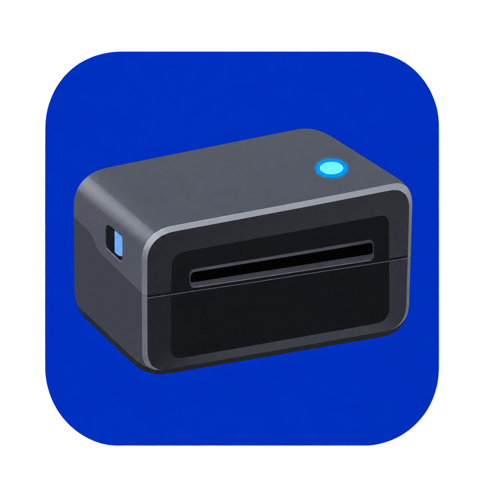
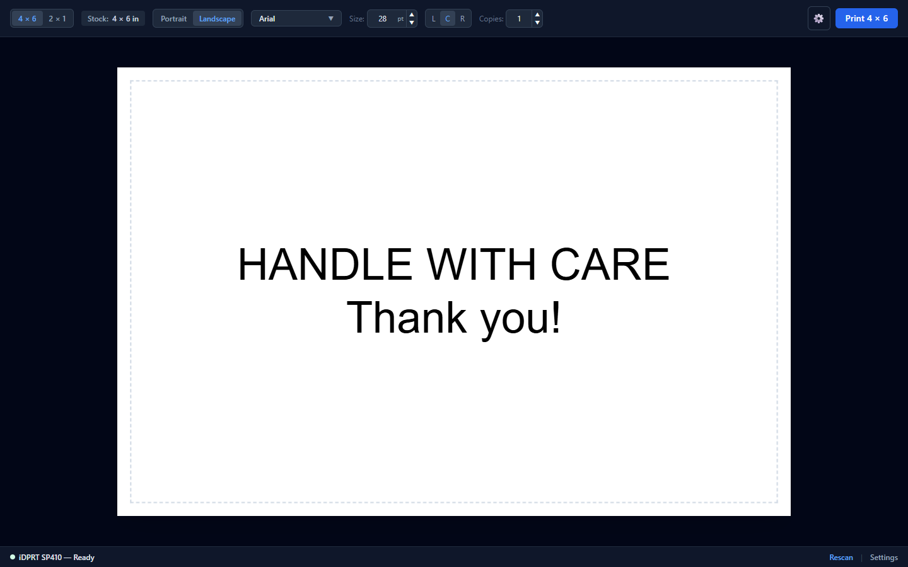
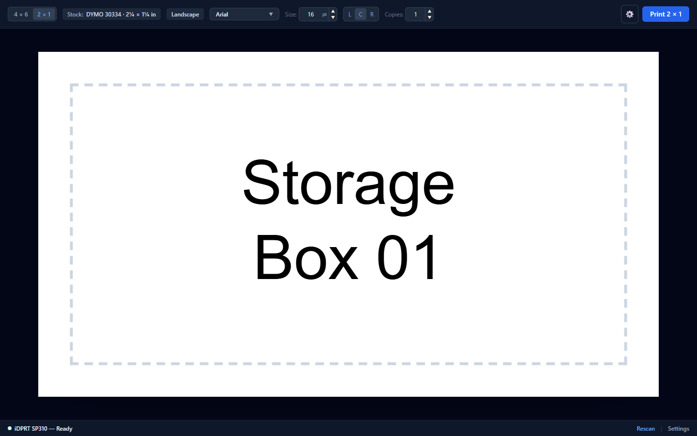

# Label Maker



[](https://github.com/dwyerwilliam/LabelMakerWD/actions/workflows/build-release.yml)
[](https://github.com/dwyerwilliam/LabelMakerWD/releases/latest)
[](LICENSE)

A single-window desktop application for editing and direct thermal printing of 4 × 6 labels to the **iDPRT SP410** family and fixed-landscape 2 × 1 labels to the **iDPRT SP310** using DYMO 30334 stock over USB.

Based on [FUNCTIONAL_SPEC.md](FUNCTIONAL_SPEC.md) and [TECHNICAL_SPEC.md](TECHNICAL_SPEC.md).

<br clear="right">

## Platform and label support

This application has only been tested on Windows 11. It has not been tested on other Windows versions or operating systems. The macOS build is experimental and currently untested; it may be tested and confirmed in the future. A macOS installer does not imply that printing or other features work on macOS.

The supported label profiles are 4 × 6 for the iDPRT SP410 and 2 × 1 for the iDPRT SP310 with DYMO 30334 stock (actual size 2.25 × 1.25 inches). Additional label sizes are not planned.

## Setting up a printer

Label Maker prints to the operating system's print queue, so the printer has to be installed first.

1. Install the manufacturer's driver for your printer ([iDPRT downloads](https://www.idprt.com/downloads/SP410?type=driver)) and connect it by **USB**.
2. Add it as a normal printer in Windows (Settings → Bluetooth & devices → Printers & scanners) so a queue exists. Keep the model name (`SP410`, `SP410BT` or `SP310`) in the queue name; the app matches queues by that name.
3. Start Label Maker. The matching printer appears in the status bar of its tab (4 × 6 for the SP410, 2 × 1 for the SP310). Use **Rescan** after connecting a printer, or just switch back to the window.

Good to know:

- Only USB queues are used, and the OS default printer is never used as a fallback. If a queue was renamed, or its connection cannot be read, choose it in **Settings** and confirm that it is the USB printer.
- If the printer you chose is unplugged or removed, the app keeps your choice and asks you to choose again; it does not send labels to a different printer on its own.
- "Sent to <queue>" means the operating system accepted the job. It does not prove a label came out. If the app cannot confirm the outcome it says so and asks you to check the printer queue before printing again, so you do not get a duplicate.
- Label Maker does not save label text. Closing the window asks before it discards the label.

The editor shown with example labels and simulated printer status:

**4 × 6 landscape**



**2 × 1 landscape**



## Downloads

- [Latest release](https://github.com/dwyerwilliam/LabelMakerWD/releases/latest)
- [Release history](https://github.com/dwyerwilliam/LabelMakerWD/releases)

Choose `LabelMaker-Setup-<version>.exe` for Windows 11 x64, or the `arm64` (Apple Silicon) or `x64` (Intel) DMG for macOS. The Windows and macOS installers are built without publisher signing; macOS packages are not notarized, and the operating system may warn or block them. macOS support remains unverified. Releases include `SHA256SUMS.txt` for checking download integrity.

Because the installers are unsigned, the first run triggers an operating-system warning:

- **Windows:** SmartScreen shows "Windows protected your PC". Choose **More info**, then **Run anyway**.
- **macOS:** Control-click the app, choose **Open**, then **Open** again (or allow it under System Settings → Privacy & Security).

## Building releases

To make a release, update the version in `package.json` and `package-lock.json`, commit and push the changes, then push a matching tag (for example, `v0.1.0`). The release workflow builds all three installers, checks the tag against the package version, and publishes them with SHA-256 checksums only after every build succeeds. A manual **Build installers and release** workflow run builds downloadable Actions artifacts without publishing a release; these artifacts expire after 14 days.

## Architecture & Technology Stack

- **Framework:** Electron (isolated, context-isolated, secure custom scheme `labelmaker://app`)
- **UI:** React 19, strict TypeScript, Zustand 5
- **Build:** Vite + `vite-plugin-electron`
- **Styling:** Tailwind CSS for application chrome, isolated plain CSS (`label.css`) for physical geometry and printing
- **Testing:** Vitest for pure logic & contract schemas, Playwright for browser UI & real Electron tests

## Features

- **Strict 4 × 6 Inch Geometry:** Fixed physical dimensions (288 × 432 pt / 384 × 576 CSS px) with safe 0.125-inch margin on all edges.
- **Fixed 2 × 1 Profile:** UX profile name for the SP310/DYMO 30334 stock, rendered at the actual 2.25 × 1.25 inch landscape geometry.
- **Portrait & Landscape:** Single-sheet physical orientation with automatic 90-degree rotational mapping for landscape layout.
- **WYSIWYG Editor:** Direct editing on the label surface with vertical centering when text fits, and automatic clipping with warning when text overflows. Text is plain: pasted or dropped formatting is stripped, and blank lines print exactly as they appear.
- **Local Font Discovery:** Lists the fonts installed on the computer (Chromium's Local Font Access API) with search. A saved font that is no longer installed is replaced by Arial or the platform default, with a notice above the label naming both fonts; your choice is kept for when the font returns.
- **Print Safety:** Print is disabled for an empty label, an invalid size or copies value, a missing printer or while a job is being sent (the shortcut obeys the same rules). Clipped text, and a printer that is offline, paused or in error, each need an explicit confirmation naming the profile. If the operating system never answers, the outcome is reported as unconfirmed and nothing is retried.
- **Direct USB Printer Profiles:** Automatically recognizes SP410/SP410BT and SP310 queues, assigns them to the matching size profile, and provides profile-specific confirmation for renamed queues.
- **Atomic Settings Persistence:** Versioned atomic writes to Electron's per-user `userData/settings.json`, including migration from the original SP410-only preferences. A damaged file is saved as `settings.json.corrupt.<time>`, valid values are kept, and a notice says what was reset.

## Quick Start

```bash
# Install dependencies
npm install

# Run development server
npm run dev

# Build application bundles
npm run build:app

# Build installer for Windows
npm run package:win
```

## Testing

Nothing in the automated tests sends anything to a printer.

```bash
npm run typecheck      # application and test code
npm run test:unit      # Vitest: logic, settings, print service, IPC trust
npm run test:ui        # Playwright in a browser: editor, dialogs, print flow (mocked bridge)
npm run test:electron  # the real app: IPC, settings, close prompt, fonts, navigation guards
npm run test:packaged  # starts the packaged app (run npm run package:win or package:mac first)
```

- `test:ui` needs a Chromium for Playwright: run `npx playwright install chromium`, or point `PLAYWRIGHT_CHROMIUM_EXECUTABLE` at an installed Chromium or Chrome.
- `test:electron` runs against the built app, so run `npm run build:app` first. It uses a throwaway settings folder (the `LABELMAKER_USER_DATA_DIR` environment variable, ignored by packaged builds), so it never touches your real settings and works while Label Maker is open.
- `npm run build:native` builds the printer-inspection helper; with `CI=true` or `REQUIRE_NATIVE=1` a failed build stops instead of falling back.
- Physical printing (page size, orientation, one label per page, copies) can only be checked by printing on the real printers; see the acceptance criteria in the specification.

Continuous integration (`.github/workflows/ci.yml`) runs all of the above except the packaged check on Windows and macOS for every pull request and push; the release workflow also smoke-tests each packaged build.

## Known limitations

- Printing has only been verified on Windows 11 with an SP410 and an SP310. macOS is experimental.
- The app cannot tell whether paper came out, only whether the operating system accepted the job.
- The SP310's default paper in the driver is not DYMO 30334; the app sends its own page size, but it does not yet check the driver's media settings against the profile.
- No saved labels, images, barcodes, templates, other label sizes, Bluetooth or network printing (see the specification's exclusions).

## License

This project is licensed under the [MIT License](LICENSE).
